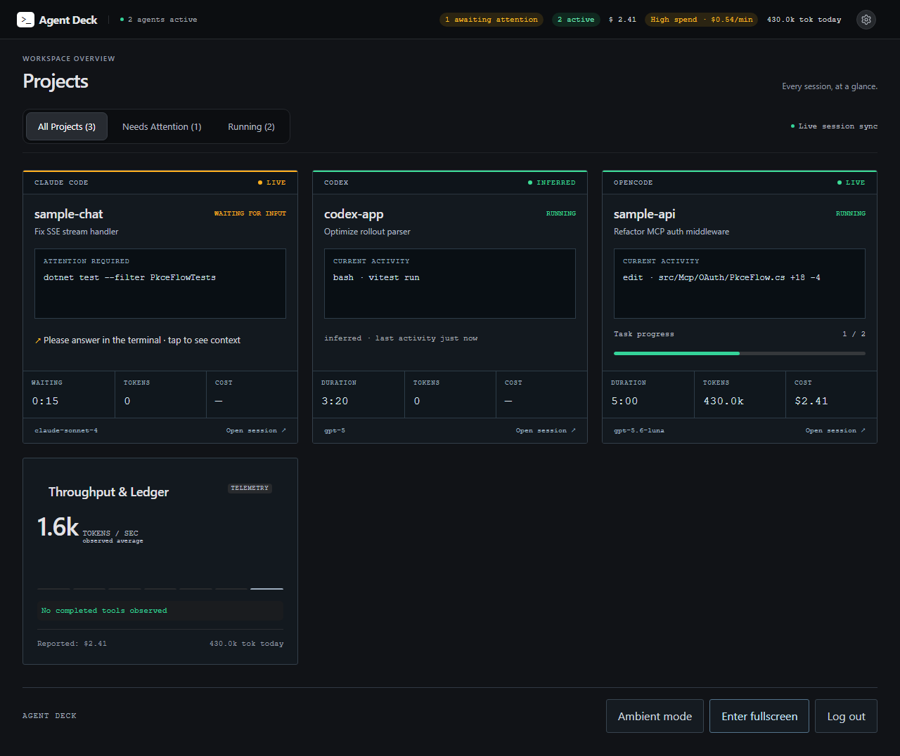

# Agent Deck

An experimental, local-first dashboard for AI coding agents. Follow OpenCode,
Claude Code, Codex and Antigravity sessions from your PC, tablet or phone: activity,
latest messages, attention requests, file changes and token usage.



Agent Deck observes your agents; it does not submit prompts, answer approvals or
change their work. Native hook installation is explicit and reversible.

## Quick start

### Install the CLI

For published npm releases, install once and run from any directory:

```sh
npm install -g agent-deck
agent-deck start
```

Requires **Node.js 22.22+ or 24** and npm 10+ on Windows or Linux (x64/ARM64).
The package includes the dashboard and prebuilt observer hooks; no repository,
Git, Go or TypeScript build is needed. Native Node dependencies may need a C++
toolchain if a compatible prebuilt binary is unavailable. ARM64 hooks are
cross-compiled; see [validation boundaries](docs/compatibility.md).

Open <http://127.0.0.1:4100> and keep the terminal running. First startup asks which
providers to enable. Use `agent-deck setup` to change them, `agent-deck doctor`
for diagnostics, and `agent-deck --version` to check the installed version.
On Windows, use `agent-deck.cmd` if PowerShell blocks the generated `.ps1` launcher.

Update with `npm install -g agent-deck@latest` after stopping the collector.
[Installation and uninstall details](docs/installation.md#npm-cli).

### Run from source

Requirements: Git, **Node.js 22.22+ or 24**, npm 10+, and Go 1.22+ for the hook shim.
Native Node modules may require a C++ toolchain if prebuilt binaries are unavailable.

```sh
git clone https://github.com/noti0nS/agent-deck.git
cd agent-deck
npm ci
npm run build
npm run agent-deck start
```

On first run, select the providers you want to enable (arrows to move, Space to
toggle, Enter to save). Detected providers are suggested; you can select none.
Claude Code and Antigravity selections install their observer hooks automatically;
reopen those agents afterward. Other providers need no hooks. Run
`npm run agent-deck setup` to change your selection later, then restart the collector.

Open <http://127.0.0.1:4100>. On Windows use `npm.cmd` if PowerShell blocks `npm`.
The first start imports up to 90 days of history from enabled providers into a local SQLite
DB. Set `AGENT_DECK_IMPORT_HISTORY=0` to skip bulk backfill. Current/recent agent
records may still be observed. Read [privacy](docs/privacy.md) before sharing access.

Runtime bundles, when published in [Releases](https://github.com/noti0nS/agent-deck/releases),
include the compiled app and Go shim. They need Node and `npm ci --omit=dev`,
but no Go/TypeScript build. See [installation](docs/installation.md).

## Tablet access

**Tailscale:** with Tailscale installed and signed in on both devices, run
`npm run agent-deck setup tailscale` and open the printed HTTPS URL. Your
Tailscale access rules authorize access; no Agent Deck pairing is required.
Setup refuses to replace a different service on the selected port. Starting the
collector does not modify Tailscale Serve.

**Private LAN without Tailscale:** run:

```powershell
npm run agent-deck pair
```

It detects the PC's LAN address, starts the collector, and displays a QR. Keep
that terminal open. If the collector is already running without LAN access,
stop it with Ctrl+C first and run `pair` again. If LAN is already enabled, `pair`
just generates another code. Use `pair --host 192.168.1.23` to select an address
when automatic detection is ambiguous. Each code is
single-use and valid for five minutes. LAN HTTP is for trusted networks; HTTPS
is required for normal PWA installation. [Detailed setup](docs/installation.md).

Do not expose the collector through public proxies, port forwarding or Tailscale
Funnel.

## Commands

Use `agent-deck COMMAND` after an npm installation,
`npm run agent-deck COMMAND` from source, or
`node apps/collector/dist/cli.js COMMAND` from a runtime bundle.

| Command | Purpose |
| --- | --- |
| `start` | Run collector and dashboard |
| `status` | Check configured address/port; exit 1 if offline |
| `doctor` | Report actual collector reachability and adapter diagnostics |
| `help` | Show CLI usage without running setup |
| `--version` | Print the installed version without running setup |
| `setup` | Select enabled providers and install/remove their observer hooks |
| `setup providers codex,opencode` | Save an explicit selection without prompts; use `none` for no providers |
| `setup claude [--dry-run]` | Install reversible Claude observer hooks |
| `setup agy [--dry-run]` | Install reversible Antigravity observer hooks |
| `setup tailscale` | Explicitly configure trusted HTTPS access |
| `uninstall [claude\|agy]` | Remove only Agent Deck hooks |
| `pair` | Start with LAN access if stopped, then generate a single-use code and QR |
| `devices list` | List paired LAN browsers (no token values) |
| `devices revoke ID` | Revoke one LAN device |
| `devices revoke-all` | Revoke all LAN devices and outstanding code |
| `import` | Import up to 90 days of available history |
| `probe --source AGENT --tail N` | Inspect normalized recent evidence in memory |
| `run -- CLI [args...]` | Observe an explicitly launched CLI through a PTY |
| `mcp` | Read-only stdio bridge for an MCP client |

`doctor` and `help` work before setup. Running with no command starts the collector.
Plain commands need no npm separator: `npm run agent-deck doctor`. To forward
flags through npm, use `npm run agent-deck -- setup agy --dry-run`.
Non-interactive first runs require an explicit provider selection before starting.

Build the shim before hook setup. Setup preserves other hook entries, backs up
settings and rejects malformed configuration. Hooks emit no decisions and exit
successfully if telemetry is unavailable, with a 100 ms self-timeout. Existing
agent sessions may need to reload their configuration.

## Configuration

Environment variables are read from the launching process, not automatically
from a `.env` file. Set custom DB/port values consistently in CLI/MCP terminals.

| Variable | Default | Purpose |
| --- | --- | --- |
| `AGENT_DECK_PORT` | `4100` | Collector HTTP/SSE port |
| `AGENT_DECK_HOST` | `127.0.0.1` | Primary bind; wildcard bind is refused |
| `AGENT_DECK_LAN_HOST` | unset | Additional explicit private IPv4 listener |
| `AGENT_DECK_SERVE_HTTPS_PORT` | `443` | HTTPS port for explicit Tailscale setup |
| `AGENT_DECK_DB_PATH` | `~/.agent-deck/collector.db` | Local data and device records |
| `AGENT_DECK_IMPORT_HISTORY` | enabled | `0` skips automatic bulk history import |
| `AGENT_DECK_UDP_ADDR` | `127.0.0.1:4101` | Claude shim ingest address |
| `AGENT_DECK_SKIP_HOOKS` | unset | `1` skips compiling the shim |
| `OPENCODE_SERVER_URL` | Registered local V2 service | Optional existing OpenCode V2 server override |
| `AGENT_DECK_CLAUDE_COMMAND` | platform CLI name | Installed Claude executable |

OpenCode integration requires V2. Agent Deck discovers and authenticates with the
existing local service; it never starts OpenCode. Sessions, usage, history, and
live events come from the V2 API, with no V1 or SQLite fallback. An explicit URL
override bypasses local service discovery and its managed authentication.

## Compatibility

Adapters use existing runtime evidence and file fallbacks. Missing optional agents
leave their adapters unavailable. Stale file records alone do not prove an agent
is running; silent long tasks need authoritative runtime evidence. Unknown model
prices are not invented, and estimated costs can differ from provider billing.

See the [platform/agent matrix](docs/compatibility.md),
[integration contracts and MCP](docs/integration-compatibility.md), and
[fixture provenance](fixtures/manifest.json). npm package CI targets Windows and Ubuntu;
check actual results before treating a platform or native CLI version as verified.

## Development

```sh
npm run build
npm run typecheck
npm test
npm run test:hooks
npx playwright install chromium
npm run test:e2e
```

[Release procedure](docs/releasing.md) | [Changelog](CHANGELOG.md) |
[Dependency review](docs/dependency-review.md)

Code lives in `apps/collector` and `apps/web`; shared logic is in `packages`.
`tools/hook-shim` contains the Go hook, and `tools/doctor` the diagnostics formatter.
Tests and screenshots use synthetic data. Design research is not a compatibility claim.

MIT - see [LICENSE](LICENSE).
